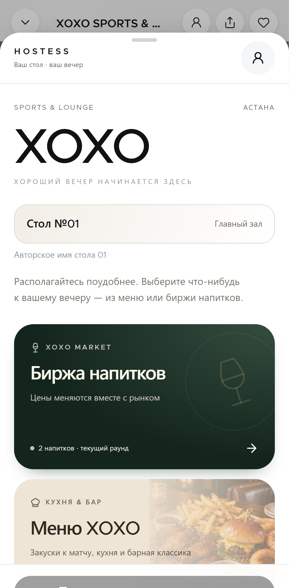
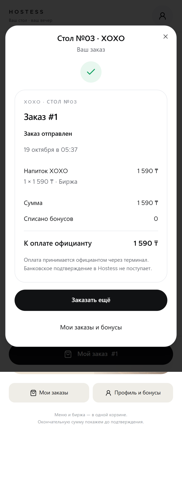

# Guest Experience 3 — acceptance and evidence

2026-10-19. Baseline `d8d0d911a060f06dbb7a686509efd9d14a5507ae`. Existing untracked menu photos in the original checkout were preserved. The existing light visual design, venue shell, photographs, maps, account/identity, booking holds, mixed-cart checkout and Cloudflare BFF are reused.

## Guest journey

The common XoxoBarSheet, reached through map/card/direct `/xoxo`, now presents **Забронировать**, **Меню и биржа**, **Я уже в XOXO**. Its normal menu also adds items to the same public basket. Mixed regular/exchange selections can become an unpaid reservation preorder or be carried into the existing DiningPage after table confirmation. Booking snapshots are estimates; future exchange execution prices are not guaranteed.

**Already at XOXO without QR:** ask staff to confirm seating and issue the short code; enter it, confirm the table, review a fresh server quote and use the existing checkout. The temporary owner-bound visit capability never reveals the permanent QR token. An arbitrary public table number cannot create an order. Expiry/release/identity changes fail closed and require new context; receipt ownership stays separate per guest.

**Booking without QR:** existing date/time/party/resource selection, availability, holds, canonical reservations, guest bootstrap and own history continue to work. If no automatically confirmable place is selected, **Оставить заявку на бронирование** saves an idempotent pending request without allocating a place. Manager confirms a real available resource in Command Center; the guest sees pending/confirmed/rejected in their cabinet. Missing capacity or unverified mapping never becomes invented availability.

**After checkout:** receipt shows actual server amounts, table/zone, bonuses, human service status and optional staff payment acknowledgement. Status refreshes every four seconds while the receipt is open and on focus; failed refresh is visibly stale. New orders are “Заказ отправлен”, not prematurely “Принят сотрудником”. “Заказать ещё” continues using the same checkout. Bank confirmation is never claimed.

The BFF only adds allowlisted code-claim and booking-request routes and continues to forward owner cookies and Set-Cookie. Service keys stay server-side. Code claims create no sale or loyalty movement. Registration and existing identity/merge proofs are unchanged. Anonymous orders earn no cashback; current 3%/14-day/FIFO rules remain server-owned.

## Server dependency and rollout

Deploy Command Center's additive `0011_service_operations.sql` and compatible APIs before this frontend. The cross-repository contract is in `hostess-command-center/docs/SERVICE_EXPERIENCE_3_CONTRACT.md`; a matching copy accompanies this document.

No second reservation/order/wallet system was introduced. Staff-created and QR/code-created exchange items all use the canonical Command Center outbox, with source differences retained in order events.

## Verification

- 85 existing unit/SSR/BFF/photo tests pass; typecheck and production build pass.
- Lint has zero errors; existing shared UI warnings remain.
- Chromium mobile/desktop and iOS WebKit fixture E2E pass: all 17 QR routes, reload/cart isolation, mixed cart, unavailable products, expired quotes, redemption, interrupted-response safe retry, logout and no-QR form/modal.
- Real isolated HTTP test of this BFF → actual Command Center handler/PostgreSQL → actual XOXO routes/Prisma passed: staff mixed order, no-QR mixed order, duplicate checkout, status roundtrip, shared visit and durable outbox delivery/compensation. This is separate from browser fixture coverage; no mocked fetch was used in that test.
- Command Center browser testing uses the real server and isolated PostgreSQL and covers staff composer/folio at 320–1440px and WebKit.
- Before rollout, production regular menu returned 200 and profile returned expected 401 without a session, not 503. No production test guest/order/booking/loyalty writes were performed.

## Limits and delivery evidence

Ten-minute code expiry requires a new code for further checkout. Closing the browser does not provide background push notifications. Physical inventory still requires the owner's verified capacity/mapping. Native Railway backup was created before rollout. Production aggregate counts were read-only verified at 8/3/3/3; an approved server-only in-memory comparison confirmed unchanged QR credentials, generations, zone assignments and layouts without exporting tokens or hashes. See [delivery evidence](SERVICE_EXPERIENCE_3_DELIVERY.md). CI, PRs, deployment SHAs and read-only smoke results are recorded in the delivery addendum.
